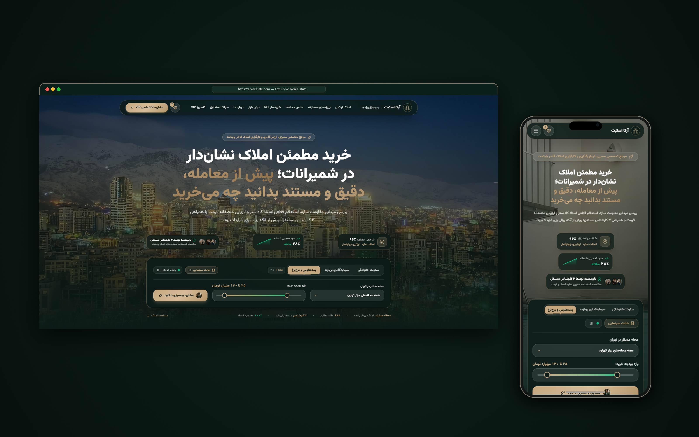
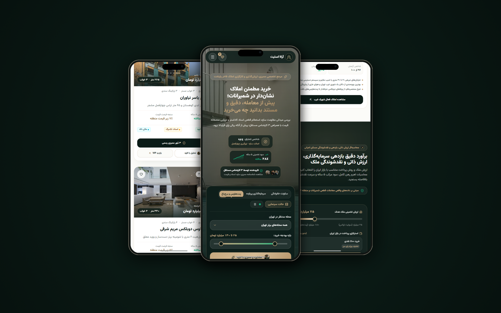
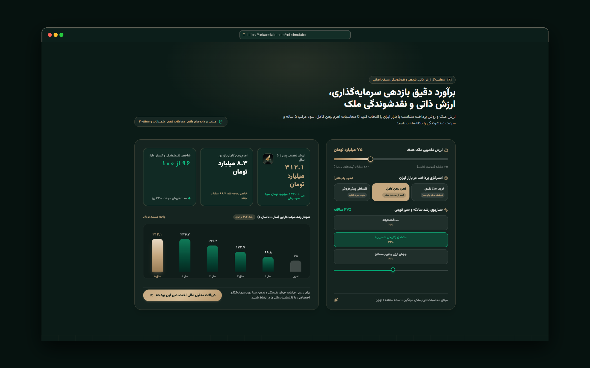

# 🚀 **2026-FE-TS-ArkaEstate--mshajkarami.dev**

> **Frontend Architecture | React 19 & TypeScript PropTech / FinTech Platform**  
> _by [mshajkarami.dev](https://mshajkarami.dev)_

[](https://react.dev/)
[](https://www.typescriptlang.org/)
[](https://tailwindcss.com/)
[](https://vitejs.dev/)
[](https://mshajkarami.github.io/2026-FE-TS-ArkaEstate--mshajkarami.dev/)
[](./LICENSE)

---

## 🌐 Live Platform & Source

* 🚀 **Live Demo on GitHub Pages:** **[https://mshajkarami.github.io/2026-FE-TS-ArkaEstate--mshajkarami.dev/](https://mshajkarami.github.io/2026-FE-TS-ArkaEstate--mshajkarami.dev/)**
* 🐙 **Source Code:** **[github.com/mshajkarami/2026-FE-TS-ArkaEstate--mshajkarami.dev](https://github.com/mshajkarami/2026-FE-TS-ArkaEstate--mshajkarami.dev)**

---

## 🖼️ Visual Showcase

<div align="center">
  
</div>

<p align="center">
  <em>ArkaEstate responsive ecosystem on Apple Studio Display & iPhone 16 Pro (Dark Titanium).</em>
</p>

---

## 🧠 Overview

**ArkaEstate (آرکا استیت)** is a high-end, editorial-grade **PropTech & FinTech advisory web platform** specifically tailored for luxury certified real estate transactions and compound wealth investment analysis in Tehran’s prestige districts (Shemiranat, Elahieh, Niavaran, Farmanieh, Zafaraniyeh).

Unlike generic listing portals, ArkaEstate bridges the gap between **quiet luxury aesthetics** and **hard mathematical financial modeling**:
* **Real Estate PropTech**: Multi-dimensional faceted discovery engine with verified cadastral audit dossiers.
* **FinTech Analytics**: Interactive compound yield and ROI simulator with dynamic liquidity forecasting.
* **Bento Architecture**: Modern modular design highlighting triple independent board certifications (Structural, Legal, Financial).
* **AI Concierge**: Specialized persona engine (*Kaveh AI*) with multi-stage thinking steps and private consultation scheduling.

> 🧩 Designed with clean component-driven architecture, modular state management, and strict TypeScript type-safety.

---

## ⚙️ Tech Stack

| Category | Technologies |
| :--- | :--- |
| **Language** | TypeScript (ES2022+), JavaScript |
| **Core Library** | React 19 (Component-driven, Custom Hooks, Modern Suspense patterns) |
| **Styling & Design** | Tailwind CSS (Deep Emerald `#0B1E19`, Champagne Gold `#C5A880`, Warm Paper `#FBF9F5`) |
| **Build & Tooling** | Vite 6, PostCSS, Autoprefixer |
| **Icons & Media** | Lucide React, HTML5 1080p Ambient Video Hero |
| **Architecture** | Atomic Component Architecture, Faceted Search State, Pure Math Simulator Engines |
| **Version Control** | Git + GitHub (`mshajkarami.dev` standard) |

---

## 📱 Mobile-First Trio Showcase

<div align="center">
  
</div>

<p align="center">
  <em>iPhone 16 Pro Trio Showcase: Featured Property Cards, Hero Search Console, and Financial ROI Simulator.</em>
</p>

---

## 💡 Key Features

- 🏛️ **Quiet Luxury Editorial Design**: Tailored visual identity inspired by high-end private banking and architectural monographs with zero visual noise.
- 📈 **Interactive ROI & Mortgage Simulator**: Dynamic calculation of compound growth, lease leverage, inflation hedges, and liquidity turnaround timelines without reloads.
- 🔍 **Faceted Discovery Engine**: Instant real-time filtering across penthouse, garden-tower, and family residence portfolios.
- ⚖️ **Certified Audit Dossier**: Independent reviews from 3 certified authorities (Structural Engineering, Cadastral Title Attorney, Senior Wealth Analyst).
- 🤖 **Kaveh AI Concierge**: Dedicated advisory modal with thinking progress bars, contextual market suggestions, and VIP private inspection bookings.
- 📱 **Mobile-First Responsive Ergonomics**: Optimized touch targets, dynamic island integration, and smooth bottom-sheet modals.

---

## 📊 Live ROI Simulator Engine

<div align="center">
  
</div>

---

## 📂 Project Structure

```text
2026-FE-TS-ArkaEstate--mshajkarami.dev/
├── public/                     # High-resolution architectural imagery, 1080p ambient video reels, emblems
├── src/
│   ├── assets/                 # Brand assets, vectors, luxury emblems
│   ├── components/             # Reusable, decoupled UI components
│   │   ├── Navbar.tsx          # Glassmorphic header with live district selectors
│   │   ├── HeroSection.tsx     # Cinematic ambient video hero with purpose reels
│   │   ├── PropertyShowcase.tsx# Luxury property grid with filter pills
│   │   ├── PropertyAuditPage.tsx# Deep-dive cadastral and structural inspection dossier
│   │   ├── RoiSimulator.tsx    # Interactive compound financial math engine
│   │   ├── ExpertsSection.tsx  # Triple independent expert review panel
│   │   ├── NeighborhoodAtlasSection.tsx # Micro-location market intelligence
│   │   ├── KavehChatModal.tsx  # Multi-stage AI concierge interface
│   │   └── ...
│   ├── data/                   # Structured properties dataset, neighborhood metrics, expert profiles
│   ├── utils/                  # Mathematical formatters, Persian currency parsers, date helpers
│   ├── App.tsx                 # Root application controller & hash router
│   ├── index.css               # Tailwind directives & luxury design tokens
│   └── main.tsx                # Application bootstrap
├── docs/                       # Architectural specifications & identity books
│   ├── BRAND_IDENTITY_SPEC.md  # Brand colors, typography, tone of voice
│   ├── KAVEH_AI_PERSONA_SPEC.md# AI concierge prompt guidelines & persona rules
│   └── UI_UX_DESIGN_SPEC.md    # Component specifications & responsiveness rules
├── showcase/
│   └── mockups/                # Ultra-high-res 3200x2000 Apple studio device mockups
├── index.html                  # HTML entry with custom typography & meta tags
├── package.json                # Project dependencies and npm scripts
├── tsconfig.json               # TypeScript compiler options
├── vite.config.ts              # Vite bundler configuration
├── LICENSE                     # mshajkarami.dev official license (v1.0)
└── README.md                   # Project documentation
```

---

## 🚀 Getting Started

### Prerequisites
* Node.js `18.x` or higher
* npm or yarn or pnpm

### Installation

1. **Clone the repository:**
   ```bash
   git clone https://github.com/mshajkarami/2026-FE-TS-ArkaEstate--mshajkarami.dev.git
   cd 2026-FE-TS-ArkaEstate--mshajkarami.dev
   ```

2. **Install dependencies:**
   ```bash
   npm install
   ```

3. **Start local development server:**
   ```bash
   npm run dev
   ```
   Open [http://localhost:3000](http://localhost:3000) in your browser.

4. **Build for production:**
   ```bash
   npm run build
   ```

---

## 🧩 Implementation Highlights

| Area | Description |
| :--- | :--- |
| **UI/UX Craftsmanship** | Dark luxury emerald palette (`#081411`), champagne gold accents, balanced whitespace, and subtle border radiance |
| **Responsiveness** | 100% fluid layouts supporting mobile viewports (375px+), tablets, and high-density 4K displays |
| **Code Quality** | Clean component boundaries, strictly typed props, modular hooks, zero ESLint/TypeScript warnings |
| **Performance** | Sub-second hydration, optimized image formats, graceful fallback for offline video assets |

---

## 👨‍💻 About the Developer

**Mohammad Saleh Hajkarami** — _Computer Engineering Student_  
📍 Mohajer University of Isfahan  
💻 Frontend & Android Software Engineer  
🚀 Founder of **[mshajkarami.dev](https://mshajkarami.dev)**  
🐙 [GitHub Profile](https://github.com/mshajkarami)  
💼 [LinkedIn Profile](https://linkedin.com/in/mshajkarami)

> Passionate about building structured, scalable, and developer-friendly systems.

---

## 🪄 License

This project is licensed under the official **mshajkarami.dev License (v1.0)**.  
See the [LICENSE](./LICENSE) file for complete terms and permissions.

---

> _“Code is temporary, but structure is forever.”_  
> — **[mshajkarami.dev](https://mshajkarami.dev)**
