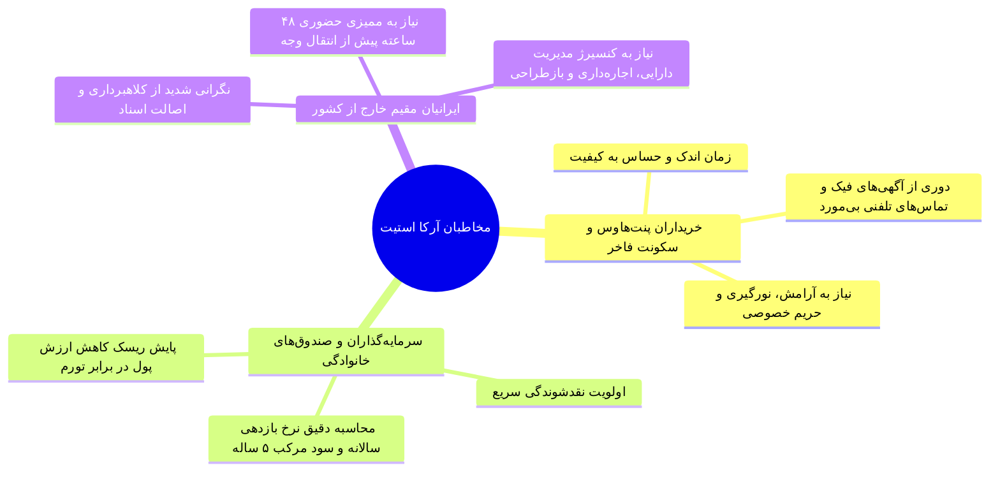
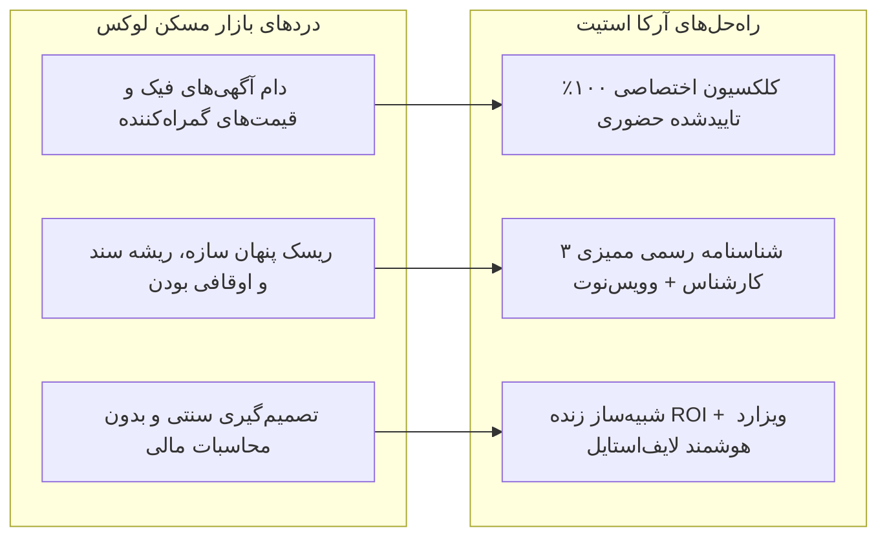
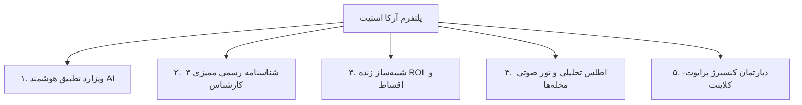

# سند هویت برند و منشور استراتژیک آرکا استیت (ArkaEstate Brand Identity Specification)

> **نسخه سند:** ۱.۰ (مصوب پاییز ۱۴۰۴ / ۲۰۲۶)  
> **موقعیت در پورتفولیو:** پروژه ۰۱ — پلتفرم هوشمند مشاوره و سرمایه‌گذاری املاک لوکس  
> **مسیر پروژه:** `D:\Website Portfolio\01-Smart-Advisor-RealEstate\آرکا-استیت-_-arkaestate`

---

## ۱. مانیفست و هویت بنیادین (Core Manifesto & Positioning)

### ۱.۱. تعریف یک‌خطی (Elevator Pitch)
**آرکا استیت (ArkaEstate)** یک پلتفرم هوشمند تصمیم‌گیری، ممیزی مهندسی و مدیریت دارایی‌های ملکی در تراز پرایوت‌بنکینگ (Private Banking) است که با ترکیب هوش محاسباتی، نظارت مستقل ۳ کارشناس رسمی و طراحی ژورنالی فاخر، ریسک معاملات چند ده میلیاردی را به صفر می‌رساند.

### ۱.۲. تمایز بنیادین با پلتفرم‌های سنتی
* آرکا استیت **یک بازارگاه باز (Open Marketplace)** مثل دیوار یا دلتا نیست که هر دلال یا مشاور در آن فایل بگذارد.
* آرکا استیت یک **کلکسیون فوق‌لوکس فیلترشده (Bespoke Curated Collection)** است که ورود به آن نیازمند عبور از فیلتر ممیزی ۱۰۰ پوینتی است.

### ۱.۳. شعارها و بیانیه‌های رسمی
* **شعار اصلی:** «خانه‌ای که دقیقاً با سبک زندگی و آینده مالی شما نفس می‌کشد.»
* **شعار سرمایه‌گذاری:** «سرمایه‌گذاری بر پایه دیتای واقعی معاملات، نه حدس و گمان‌های بازار.»
* **شعار حقوقی:** «صفر درصد ریسک قراردادی؛ معامله در سایه ممیزی ۳ کارشناس مستقل.»

---

## ۲. پرسونای مخاطبان هدف (Target Audience Personas)

1. **پرسونای ۱: خریدار سکونت لوکس (HNWI):**
   * دغدغه: «من فرصت ساعت‌ها گشتن در سایت‌ها و شنیدن وعده‌های دروغین دلالان را ندارم؛ ملکی می‌خواهم که سازه و نقشه‌اش از آزمون معماران تراز اول رد شده باشد.»
2. **پرسونای ۲: سرمایه‌گذار دارایی‌های سنگین (Wealth Builder):**
   * دغدغه: «نمی‌خواهم پولم در ملکی که نقدشوندگی‌اش ۲ سال طول می‌کشد خواب برود؛ من عدد، گزارش فصلی نبض بازار و شاخص بازگشت سرمایه (ROI) می‌خواهم.»
3. **پرسونای ۳: هم‌وطن مقیم دبی، کانادا یا اروپا (Expat Investor):**
   * دغدغه: «من در تهران نیستم و دسترسی حضوری به دفتر اسناد رسمی ندارم؛ می‌خواهم یک هیئت حقوقی مستقل استعلام کاداستر و پایان‌کار را به صورت مکتوب و تضمین‌شده به من ارائه دهد.»

---

## ۳. سه درد بزرگ بازار مسکن لوکس و راه‌حل آرکا استیت

### درد اول: دام فایل‌های فیک (Fake Listings Trap)
* **در بازار:** بیش از ۶۰٪ فایل‌های متراژ بالا در پلتفرم‌ها صرفاً عکس‌های ژورنالی خارجی برای شکار شماره تلفن مشتری هستند.
* **راه‌حل آرکا:** سیاست *Zero-Fake*؛ ضبط اختصاصی گالری تصاویر، ویدیوهای ۳۶۰ درجه و احراز قطعی مالکیت.

### درد دوم: ریسک وحشتناک حقوقی و نقایص پنهان سازه (Legal & Structural Disasters)
* **در بازار:** قراردادهای میلیارد تومانی بدون استعلام دقیق ریشه سند، بدهی‌های تامین اجتماعی یا تست مقاومت مصالح تنظیم می‌شوند.
* **راه‌حل آرکا:** **شناسنامه رسمی ممیزی ۳ کارشناس (3-Expert Audit Dossier)**:
  1. *مُهر اول: مهندس ارشد سازه و معماری* (تست اسکلت، عایق صوتی، تاسیسات چیلر و پلان نورگیری).
  2. *مُهر دوم: وکیل پایه یک ثبت اسناد* (استعلام کاداستر، ریشه ثبتی، پایان‌کار و عدم خلافی شهرداری).
  3. *مُهر سوم: تحلیلگر ارشد سرمایه‌گذاری ملکی* (محاسبه سنجه قیمت منطقه، شاخص نقدشوندگی و سود مرکب).

### درد سوم: نبود ابزار تصمیم‌گیری هوشمند و دیتامحور (Blind Buying)
* **در بازار:** خریدار بر اساس سخنان چرب‌زبانانه مشاور تصمیم می‌گیرد.
* **راه‌حل آرکا:** ابزارهای ریاضی تعاملی شامل **شبیه‌ساز زنده بازگشت سرمایه** و **ویزارد تطبیق هوشمند لایف‌استایل (AI Match Wizard)**.

---

## ۴. ویژگی‌های کلیدی پلتفرم (The 5 Competitive Moats)

### ۱. ویزارد تطبیق هوشمند (`Smart Match Wizard`):
* الگوریتم امتیازدهی لایف‌استایل بر پایه ۴ فاکتور:
  - هدف خرید (سکونت آرامش‌بخش، سرمایه‌گذاری پربازده، پنت‌هاوس خاص)
  - بازه بودجه و نقدینگی (۲۵ تا بیش از ۱۵۰ میلیارد تومان)
  - محله‌های هدف شمیرانات و غرب تهران
  - استخراج درصد تطابق (`Match Score: 96%`)

### ۲. شناسنامه رسمی ممیزی ۳ کارشناس (`Certified Audit Board`):
* جایگزین مدرن و سازمانی چت‌روم با ۳ مُهر رسمی دیجیتال.
* چک‌لیست ۶ مرحله‌ای شفاف و فایل صوتی کوتاه (Voice Note) مهندسان برای رفع هرگونه شبهه پیش از واریز بیعانه.

### ۳. شبیه‌ساز پویا و لحظه‌ای مالی (`Live ROI & Mortgage Simulator`):
* رندر آنی نمودار رشد ارزش ۵ ساله بر اساس دیتای معاملات منطقه.
* محاسبه زمان سربه‌سر شدن نقدینگی، سود سالانه حاصل از رهن و اجاره، و اقساط ماهانه بدون نیاز به رفرش صفحه.

### ۴. اطلس تحلیلی و تور صوتی محله‌ها (`Neighborhood Lifestyle Atlas & Audio Tour`):
* پلیر شناور صوتی با گویندگی لحن مستند معمارانه برای تشریح اقلیم، آرامش و نقدشوندگی هر محله (نیاوران، الهیه، فرمانیه، شهرک غرب).

### ۵. خدمات پرایوت-کلاینت و کنسیرژ اختصاصی (`Private Concierge Services`):
* بازرسی فنی ۴۸ ساعته حضوری.
* تضمین ۱۰۰٪ اصالت مبایعه‌نامه با وکیل اختصاصی.
* مدیریت دارایی و نگهداری دوره‌ای برای ایرانیان خارج از کشور.
* بازطراحی و فرنیش کامل با برندهای لوکس اروپایی.

---

## ۵. دیزاین سیستم و هویت بصری (Design System Tokens)

* **سبک بصری:** *Quiet Luxury Minimal Editorial* (لوکس آرام، باوقار و ژورنالی).
* **پالت رنگی برند:**
  * رنگ عمیق برند: `#0B1B17` (مشکی-زمردی نفیس / Deep Forest Emerald)
  * رنگ تأکید و دکمه‌های اکشن: `#C5A880` (طلای شامپاینی متالیک / Champagne Gold)
  * رنگ برنزی ثانویه: `#9A7D56` (برنز کهنه‌کاری شده / Muted Bronze)
  * پس‌زمینه گرم محتوا: `#FBFBF8` (کاغذی ابریشمی / Warm Alabaster)
  * شیشه‌ای مات: `backdrop-blur-xl` با حاشیه‌های ظریف `border-[#C5A880]/35`
* **تایپوگرافی:**
  * فارسی: `Vazirmatn` با اوزان Black و ExtraBold برای تیترهای باشکوه و Medium برای متن روان.
  * لاتین برندینگ: `Cormorant Garamond` (سریف سلطنتی برای کلمه ArkaEstate).
* **مکانیک ناوبری:**
  * نوبار کپسولی شناور (`h-16`) با قابلیت **تغییر خودکار تم رنگی (Chameleon System)** متناسب با سکشن جاری.
  * اسکرول‌بار فوق‌باریک ۵ پیکسلی طلایی و مینیمال.
  * تقارن شناورهای دو گوشه: FAB ویزارد هوشمند در راست، پلیر تور صوتی در چپ.

---

## ۶. نقشه راه و ایده‌های توسعه در آینده (Future Roadmap)

1. **امضای دیجیتال و بارکد استعلام ممیزی:**
   * امکان اسکن QR Code روی برگه ممیزی جهت مشاهده تاییدیه نظام مهندسی و اداره ثبت.
2. **تور واقعیت مجازی ۳۶۰ درجه (WebXR / 3D Virtual Walkthrough):**
   * پیاده‌سازی متریال شیدر در Three.js برای راه رفتن مجازی در تراس‌گاردن و لابی پنت‌هاوس‌ها.
3. **هوش مصنوعی پیش‌بینی قیمت (AI Predictive Valuation):**
   * پیش‌بینی نرخ هر متر مربع تا ۱۲ ماه آینده با رگرسیون دیتای بانک مرکزی و تورم منطقه‌ای.
4. **پنل اختصاصی سرمایه‌گذار (Investor Dashboard):**
   * پیگیری سود لحظه‌ای املاک نشان‌شده و مقایسه راداری دو فایل ملکی با جدول مقایسه فنی.

---

## ۷. هوش مصنوعی اختصاصی: مهندس کاوه (Kaveh AI Advisor)

* **جایگاه:** مشاور ارشد مجموعه آرکا استیت.
* **تصویر سورس رسمی:** `public/kaveh.jpg` (۱۰۲۴×۱۰۲۴ با کت زمردی سفارشی و نورپردازی عصرگاهی).
* **سند جامع شخصیت و پرامپت سیستمی:** [سند شخصیت هوش مصنوعی کاوه (KAVEH_AI_PERSONA_SPEC.md)](./KAVEH_AI_PERSONA_SPEC.md)
* **ویژگی‌های رفتاری:** ممیزی بی‌طرفانه، صفر تعارض منافع، ادبیات داده‌محور و پرایوت‌بنکینگ، فاقد هرگونه تکیه‌کلام دلال‌مآبانه سنتی.

