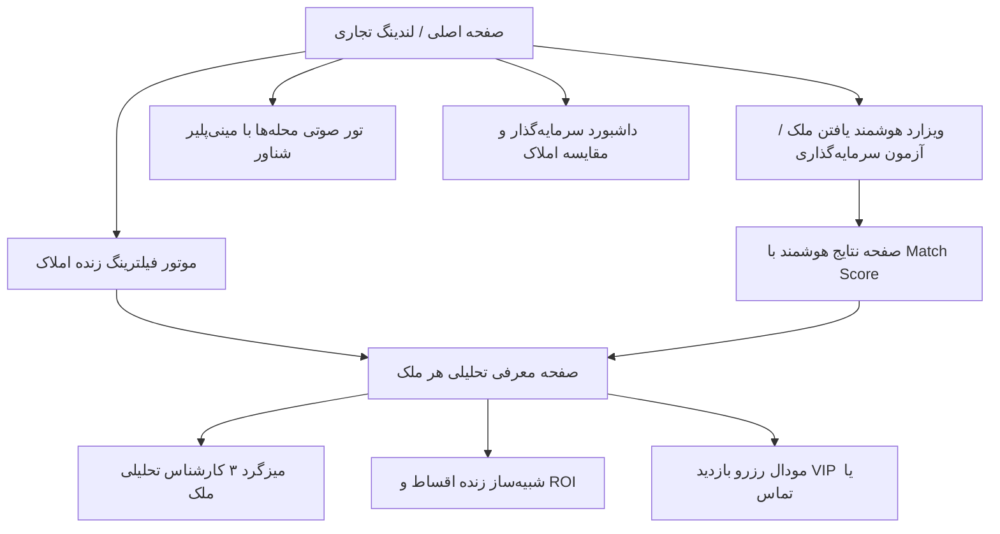

# پلتفرم هوشمند مشاوره و سرمایه‌گذاری املاک لوکس (ArkaEstate / Smart Advisor)

> **هدف استراتژیک:** اثبات تسلط شما بر طراحی پلتفرم‌های تجاری پرمخاطب با گردش مالی بالا، فیلترینگ چندبعدی داده‌های سنگین، ماشین‌حساب‌های تعاملی مالی و هویت بصری لوکس (High-End Luxury UI).
> 
> 📘 **سند تفصیلی طراحی رابط کاربری و نوبار/هیرو:** [مشاهده مشخصات طراحی UI/UX (UI_UX_DESIGN_SPEC.md)](./UI_UX_DESIGN_SPEC.md)

---

## ۱. هویت بصری، پالت رنگی و تایپوگرافی
* **پالت رنگی:** 
  * رنگ اصلی (Deep Emerald): `#112A24` (نماد اصالت، سرمایه‌گذاری امن و ثروت پایدار)
  * رنگ شاخص و تأکیدی (Champagne Gold): `#C6A875` (برای دکمه‌های ویژه، درصدها و نرخ بازدهی)
  * پس‌زمینه اصلی (Warm Alabaster): `#F9F8F5` (کاغذی، چشم‌نواز و آرام)
  * خاکستری خنثی برای خطوط مرزی: `#E5E7EB`
* **سبک طراحی:** Luxury Editorial Minimal — حاشیه‌های باریک و دقیق، عکس‌های فول‌اسکرین با نسبت ۱۶:۹ و اسلایدهای بدون کادر، کارت‌های معلق با سایه‌های محو و گرادیان‌های نرم طلایی.
* **تایپوگرافی:** تیترهای سریف/سنگین با وقار، اعداد فارسی مدرن و بولد برای قیمت‌ها، متراژ و درصد سودآوری.

---

## ۲. معماری صفحات و تجربه کاربری (UX Flow)

---

## ۳. ویژگی‌های منحصربه‌فرد و متمایزکننده (Killer Features)

### الف) شبیه‌ساز زنده بازگشت سرمایه و اقساط (Live Investment & Mortgage Simulator)
* ویجت تعاملی داخل صفحه هر ملک یا در صفحه ابزارها:
  * اسلایدر پیش‌پرداخت (مثلاً ۲۰٪ تا ۸۰٪)
  * اسلایدر مدت زمان بازپرداخت (۱ تا ۱۰ سال)
  * ورودی نرخ تورم سالانه و سود تخمینی رهن و اجاره
* **خروجی لحظه‌ای بدون رفرش:**
  * نمودار گرافیکی تفکیک اصل پول، بهره و رشد تخمینی ارزش ملک طی ۵ سال آینده
  * محاسبه لحظه‌ای «شاخص نقدشوندگی» و «زمان تخمینی سر‌به‌سر سرمایه‌گذاری»

### ب) ویزارد هوشمند یافتن خانه ایده‌آل (مشابه ویزارد آزمون‌های روا)
* یک پرسشنامه ۶ تا ۸ مرحله‌ای شسته‌رفته با نوار پیشرفت طلایی:
  * مرحله ۱: هدف معامله (سکونت آرام، سرمایه‌گذاری پربازده، حفظ ارزش پول)
  * مرحله ۲: سبک زندگی (نزدیک به مراکز تجاری، ویلایی ساکت، پنت‌هاوس با چشم‌انداز)
  * مرحله ۳: بودجه و انعطاف نقدینگی
  * مرحله ۴: اولویت‌های فنی (پارکینگ اضافه، سن بنا، سیستم هوشمند BMS)
* **خروجی متمایز:** صفحه نتایج اختصاصی که هر ملک را با یک برچسب درصد تطابق نشان می‌دهد (مثلاً: *«۹۶٪ تطابق با سبک زندگی شما»*) به همراه تشریح دلایل تطابق.

### ج) میزگرد ۳ کارشناس مجازی روی هر ملک (نسخه تجاری کاراکترهای روا)
* به جای نظرات ساده کاربران، در پایین صفحه هر ملک یک باکس گفتگوی جذاب مثل چت‌روم روا قرار دارد:
  1. **مهندس سازه و معماری:** نقد متریال ساخت، نورگیری، پلان نقشه و کیفیت مشاعات.
  2. **مشاور حقوقی و اسناد:** ارزیابی وضعیت سند (تک‌برگ، اوقاف، پایان‌کار) و ریسک‌های قراردادی.
  3. **تحلیلگر ارشد سرمایه‌گذاری:** مقایسه نرخ رشد قیمت منطقه، تقاضای رهن و اجاره و سرعت نقدشوندگی.
* کاربر با کلیک روی آواتار هر کارشناس، رزومه، شماره پروانه نظام مهندسی و سوابق او را در یک مودال لوکس مشاهده می‌کند.

### د) پادکست و تور صوتی محله‌شناسی با پلیر شناور (Floating Neighborhood Audio Guide)
* استفاده از همان پلیر موفق سایت روا:
  * در حین مرور املاک هر منطقه (مثلاً نیاوران، دروس یا شهرک غرب)، پلیر شناور گوشه صفحه یک صوت ۱ تا ۲ دقیقه‌ای با صدای جذاب درباره تاریخچه محله، دسترسی به اتوبان‌ها، دنج بودن کوچه‌ها و مراکز رفاهی پخش می‌کند.

---

## ۴. مکانیک‌های گیمیفیکیشن و درگیرکننده (Gamification)

1. **سنجه فرصت طلایی (Deal Opportunity Gauge):**
   * یک عقربه گرافیکی شبیه سرعت‌سنج ماشین که نشان می‌دهد این ملک چند درصد زیر قیمت کارشناسی منطقه است (ارزیابی تخفیف و ارزشمندی خرید).
2. **شبیه‌ساز سبد سرمایه‌گذاری مجازی (Virtual Property Portfolio):**
   * کاربر دکمه «افزودن به سبد سرمایه‌گذاری» را می‌زند؛ یک پنل پاپ‌آپ میزان سود کل سرمایه، اجاره ماهانه کل و تنوع جغرافیایی سبد کاربر را با انیمیشن‌های عددی و نموداری جذاب نشان می‌دهد.
3. **مقایسه دوبه‌دو (Side-by-Side Comparison Arena):**
   * امکان کشیدن و رها کردن (یا انتخاب با دکمه) ۲ تا ۳ ملک در جدول مقایسه؛ ویژگی‌های بهتر با تیک سبز متحرک هایلایت می‌شوند.

---

## ۵. مهارت‌های فنی و دیزاینی به نمایش گذاشته شده در این نمونه‌کار

* **معماری فرانت‌اند و وضعیت:**
  * مدیریت وضعیت محاسبات زنده مالی (Financial Math State Engine)
  * فیلتر چندبعدی (Faceted Search) بدون افت فریم حتی با ده‌ها آیتم
  * استیت ماشین فرم‌های چندمرحله‌ای با قابلیت ذخیره موقت در LocalStorage
* **طراحی UI/UX:**
  * اجرای زبان طراحی Ultra-Luxury بدون شلختگی و با کنتراست رنگی استادانه
  * تعاملات میکرو (Hover states، تولتیپ‌های توضیحی، لودینگ اسکلتی Skeleton UI)
  * تجربه کاربری فوق‌العاده روی موبایل (Mobile Bottom Sheet برای فیلترها و ماشین‌حساب)

---

## ۶. سناریوی دمو برای کارفرما (Pitch Storyboard)

> **چگونه این پروژه کارفرما را شیفته می‌کند؟**
> به کارفرما نشان می‌دهید: «کاربر شما با پاسخ به ۴ سؤال در ویزارد، به جای غرق شدن در صدها آگهی بی‌ربط، دقیقاً به خانه منطبق با بودجه‌اش می‌رسد، پادکست محله را گوش می‌دهد، نظر کارشناس سازه و سرمایه‌گذاری را می‌خواند و در همان لحظه با ماشین‌حساب اقساطش را می‌سنجد و دکمه هماهنگی بازدید را لمس می‌کند.» این یعنی افزایش نرخ تبدیل لید به مشتری از ۱٪ به بیش از ۵٪!
